# Architecture (C4)

The [C4 model](https://c4model.com) at three zoom levels, in Mermaid so GitHub
renders it. Why it is this way is in [adr/](adr/README.md), and the rules it
implies in `CLAUDE.md`. The idea through all three levels: **the LLM is not in
charge.** It refines the query and reads products out of pages; filtering,
grounding, ranking and ordering are Python.

Every diagram draws with one key:

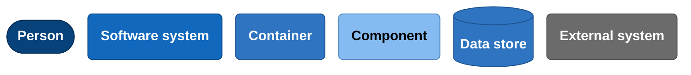

Thick arrows are a run's steps, numbered in order. Solid ones are calls and
requests, with the technology in brackets where one leaves the process; dashed
ones are dependencies, what a part reads, builds or relies on. A dashed outline is
a boundary: the system, or the container whose parts are drawn.

## Level 1 -- System context

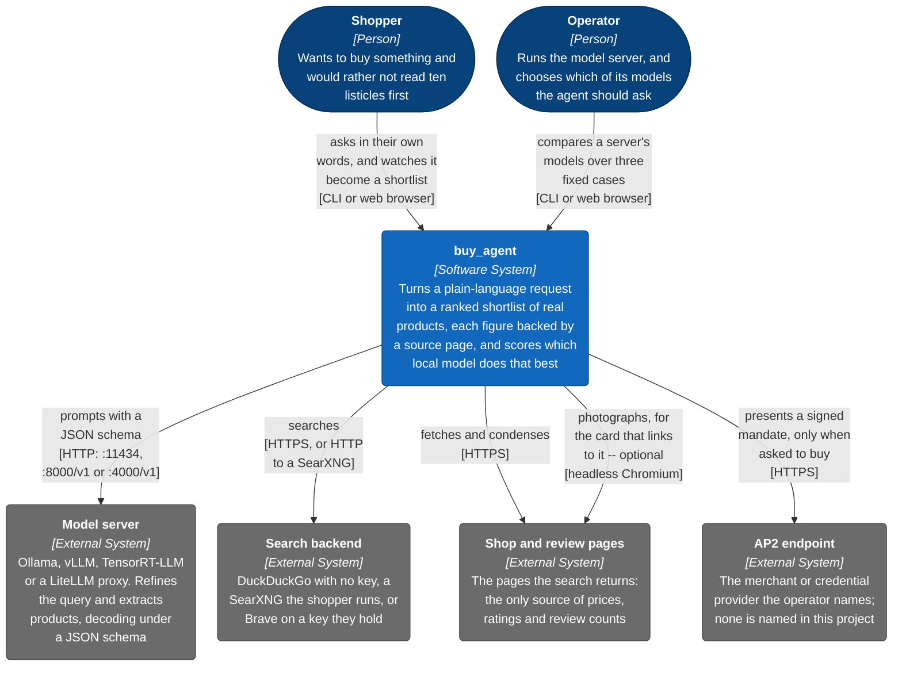

Everything runs on machines the shopper controls. Only the search and the page
fetches leave, plus the camera's second visit where a loopback server takes
pictures
([ADR-0065](adr/0065-photograph-each-products-page-from-a-server-bound-to-this-machine.md))
and a signed AP2 mandate where a run was asked to buy; the default rail charges
nobody ([ADR-0046](adr/0046-pay-on-the-shoppers-behalf-with-ap2.md)). Which model
server answers is `AgentConfig.provider`, and only `buy_agent/providers.py` knows
the difference ([ADR-0028](adr/0028-serve-the-model-from-ollama-or-vllm.md),
[ADR-0029](adr/0029-one-table-per-model-server.md),
[ADR-0068](adr/0068-reach-a-litellm-proxy-as-a-third-model-server.md),
[ADR-0081](adr/0081-reach-tensorrt-llm-as-a-fourth-model-server.md)). The
operator's way in, the benchmark, asks the model server and nothing else: every
model is served the same fixed pages
([ADR-0070](adr/0070-compare-local-models-and-give-the-comparison-a-page.md)).

## Level 2 -- Containers

One system, drawn once per person: the shop and the benchmark. Both drive the same
agent pipeline and keep what they keep in the same directory.

### The shop

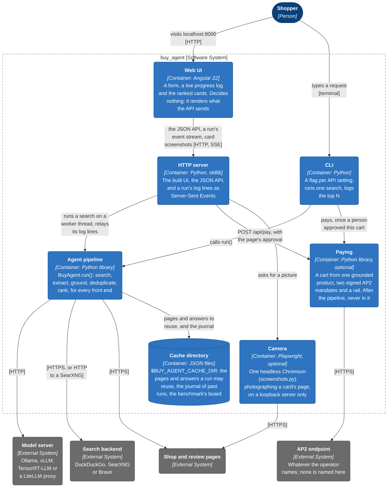

The CLI and the server are two doors onto one `BuyAgent.run()` and one table of
settings: each `api.OPTIONS` row is a flag at one door and a request key at the
other, refused in the same words at both
([ADR-0071](adr/0071-build-the-cli-flags-off-the-options-table.md)). The server is
stdlib-only and admits every request before routing it, so the API answers its own
page and not other tabs
([ADR-0018](adr/0018-guard-the-loopback-server-against-other-pages.md)). Paying is
a container of its own that both doors reach and that reaches nothing back,
settling afterwards from a product the run already grounded
([ADR-0046](adr/0046-pay-on-the-shoppers-behalf-with-ap2.md)). The camera is
further out still: the pipeline never knows it exists, and as the one part that
starts a process, only a loopback server has one
([ADR-0065](adr/0065-photograph-each-products-page-from-a-server-bound-to-this-machine.md)).

What is kept between runs is JSON under `$BUY_AGENT_CACHE_DIR`: the page text and
answers a later run may reuse, which expire and are capped by size
([ADR-0040](adr/0040-cache-the-page-text-on-disk.md),
[ADR-0044](adr/0044-remember-a-deterministic-model-answer.md),
[ADR-0052](adr/0052-cap-the-cache-by-size-as-well-as-age.md)); the journal of what
past runs of a search reported
([ADR-0060](adr/0060-keep-a-run-journal-beside-the-cache-not-in-it.md)); and the
benchmark's board, written the journal's way. Neither of the last two expires.

The `Dockerfile` ships the shop's containers as one image, without the AP2 SDK,
the camera, the benchmark or the model server
([ADR-0015](adr/0015-package-the-web-tier-as-a-container.md)). Image and release
archive are stamped with the version they are, which both doors report
([ADR-0083](adr/0083-say-which-build-is-running.md)).

### The benchmark

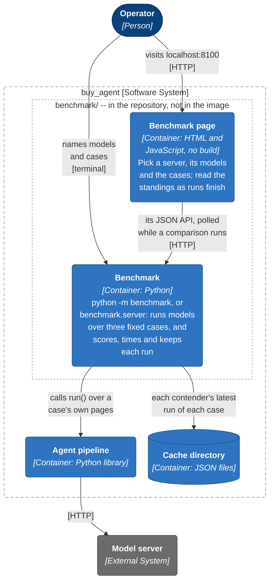

The benchmark is a third way into the same `BuyAgent.run()`, for the operator
([ADR-0070](adr/0070-compare-local-models-and-give-the-comparison-a-page.md)).
Search and fetch are swapped out on `agent` for a case's own pages, so every model
reads the same text and none of it comes off the web. Its page is three static
files with no build step, served by a subclass of the shop's handler, so a request
is admitted, refused and answered exactly as the shop's are. Nothing in the
package imports it.

## Level 3 -- Components of the agent pipeline

Too many parts for one legible picture, so the pipeline is drawn four ways: the
run step by step, what a run is built from, the types its steps share, and paying,
which comes after it.

### The run, step by step

`BuyAgent.run()`, called by either front end, calls each step in the order
numbered.

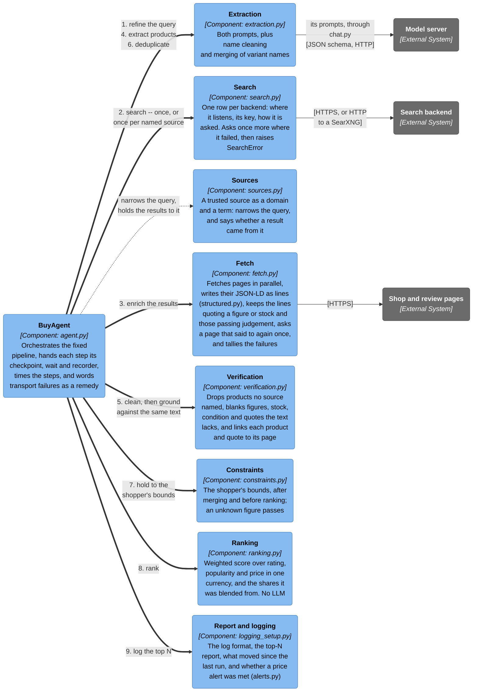

Three joints in that order bear weight. `clean_products` runs **before** `ground`,
so a name wearing its publisher suffix ("... Review | AudioSite") passes the name
check. `ground` runs **before** `deduplicate`, so merging only combines grounded
figures and links, and moves them in pairs: `models.QUALIFIERS` ties currency to
price and review count to rating, and `_fill_gaps` moves whole groups (ADR-0022).
The bounds run **after** `deduplicate`, which may supply the price, and **before**
`rank_products`, since price scores relative to the set (ADR-0039). Extraction and
verification see the same text, which is why `fetch.enrich()` puts it on
`SearchResult`.

- **Step 2** is one search, or one per named source, pooled, deduplicated by URL
  and cut back to width; only `sources.py` knows the feature exists (ADR-0021,
  ADR-0027, ADR-0057).
- **Step 3** tallies how fetching failed ("7 refused (403), 2 timed out") at INFO,
  since a run that read nothing otherwise looks like a bad model.
- **Step 5** holds quotes to a stricter bar than figures: most overlapping
  five-word runs found on one page that mentions the product (ADR-0024, ADR-0025),
  under its own name there, never a rating or count restated without a judgement
  (ADR-0090). The quote keeps that page (ADR-0042), and each product is linked to
  the first searched page mentioning it (ADR-0017).
- **Step 7** passes unknown figures, and prices outside the run's one currency,
  which is never converted (ADR-0039, ADR-0043, ADR-0056).
- **Step 8** keeps the shares a score was blended from, so an assumed 0.5 is told
  from a measured one (ADR-0041).

### What a run is built from

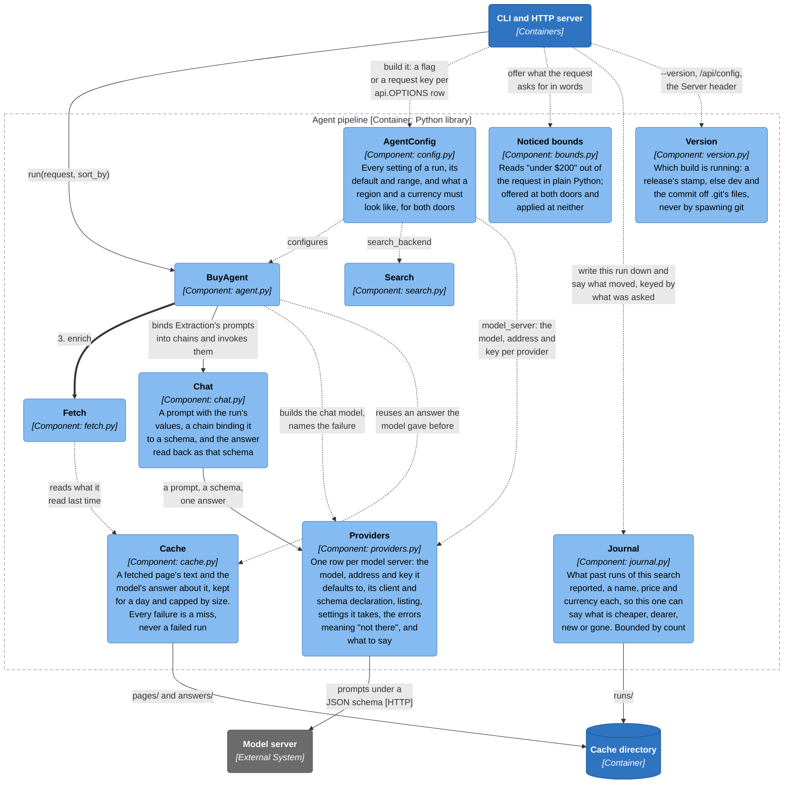

Each table is reached one way: `AgentConfig` names the row (`model_server`,
`search_backend`, and `rail_used` for paying), and nothing above it branches on a
name (ADR-0029, ADR-0046, ADR-0057). The cache wraps the chat model only for a
deterministic run, while the journal is keyed by what was asked, never by the
model (ADR-0044, ADR-0060). The version is read once and touches nothing a run
does, so a bug report can say which build wrote it (ADR-0083).

### The types every step speaks

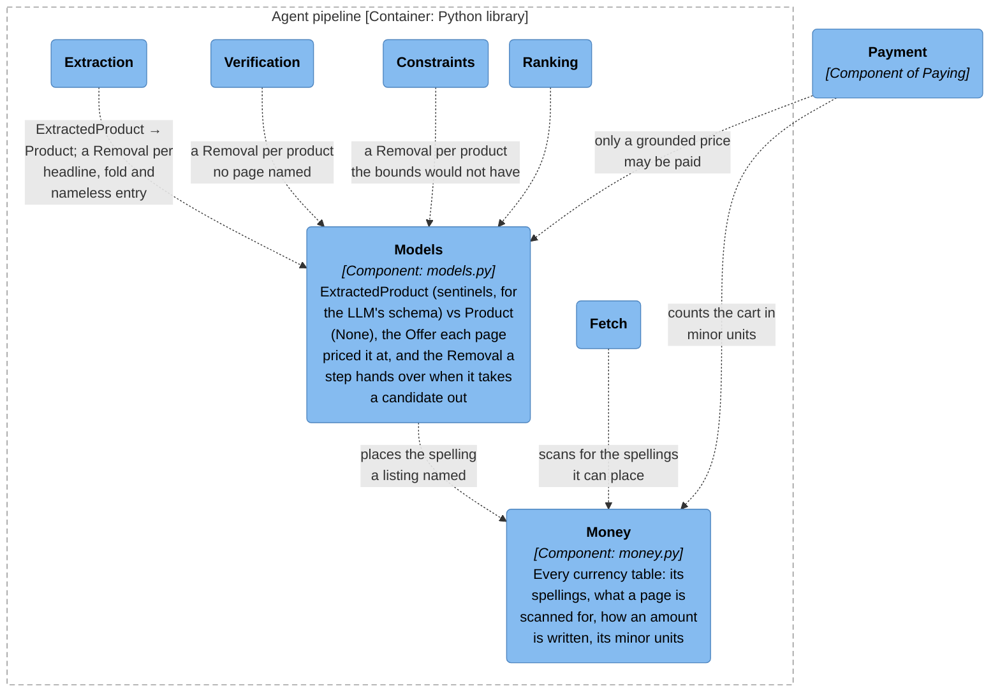

The five heuristics that take a whole candidate out (`clean_products`,
`drop_ungrounded`, `merge_variants`, `deduplicate`'s nameless drop and
`Constraints.apply`) also call `record` with a `models.Removal`, whose sentence
nothing downstream rewords; it defaults to `models.nothing_recorded`. Steps that
only blank something record nothing (ADR-0055).

### Paying

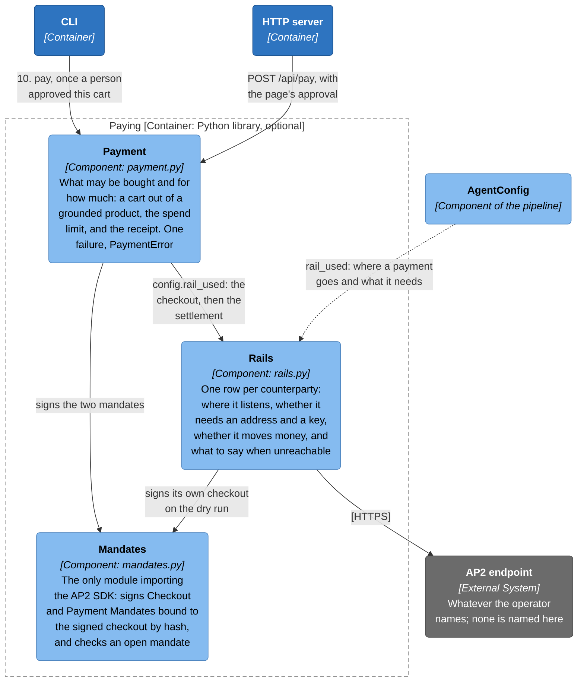

Step 10 is outside the run's order: `BuyAgent.run` ends at the report, and paying
happens afterwards to one product a person or an open mandate approved. A price no
source printed, or in a currency the run cannot place, is never paid -- the
opposite of the bounds, which keep what they cannot judge (ADR-0046).

## Level 3 -- Components of the web tier

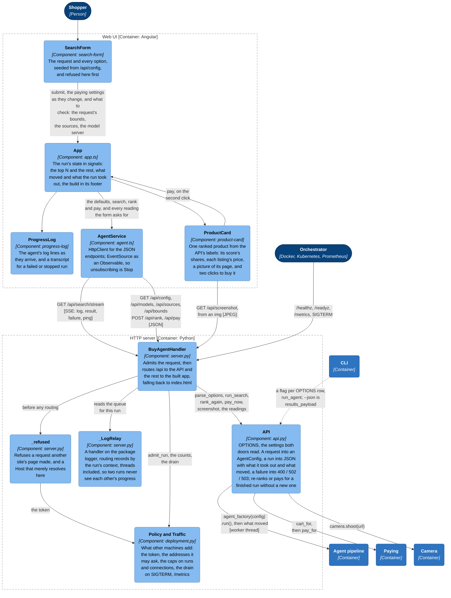

Deliberate details, each a rule in `CLAUDE.md`:

- **A run is streamed** over `GET /api/search/stream`; `POST /api/search` is the
  same run in one response, for scripts. Closing the stream stops the run at its
  next `checkpoint`, though a chat call in flight finishes (ADR-0034), and the
  failure event is `failure`, not `error`, on which `EventSource` would reconnect
  and search again.
- **Re-ordering and paying run nothing.** `POST /api/rank` calls only
  `rank_products` on the products and currency the page holds (ADR-0035,
  ADR-0056); `POST /api/pay` builds the cart on the server, and the page's echo of
  title, price and currency must match it (ADR-0012, ADR-0046). `dropped` and
  `changes` travel with the result and survive a re-sort, which reports neither of
  its own (ADR-0055, ADR-0060).
- **The browser decides nothing.** Labels such as `price_label` are Python's, and
  `sort_by` is a request even for a finished run. A picture is the card's own
  `` on `/api/screenshot`, only where `/api/config` says this server has a
  camera and the product links somewhere; it loads lazily, and a failed one drops
  its frame (ADR-0065).
- **One table of settings, two doors**, so both refuse the same values in the same
  words (ADR-0033, ADR-0071).
- **Loopback is not a boundary the browser respects**, so `_refused` turns away
  cross-site requests and foreign `Host`s before routing (ADR-0018). **Other
  machines are a boundary of their own** (ADR-0092): the probes answer before any
  check and everything else asks for the token once one is set; bound beyond
  loopback, the server asks only the model server and merchant it was started
  with; a re-sort or payment must bring back the run's `seal`; runs past
  `--max-runs` are a 503; and SIGTERM drains what is in flight.

## Level 3 -- Components of the benchmark

```mermaid
---
config:
  flowchart:
    wrappingWidth: 400
    nodeSpacing: 28
    rankSpacing: 50
---
graph TB
    operator(["<b>Operator</b><br/><i>[Person]</i>"])
    benchpage("<b>Benchmark page</b><br/><i>[Container: benchmark/web]</i><br/>Draws what /api/state<br/>answers, sends what the<br/>form says, and writes text,<br/>never markup")

    subgraph benchmark["Benchmark [Container: Python, not shipped]"]
        commandline("<b>Command line</b><br/><i>[Component: __main__.py]</i><br/>python -m benchmark: every<br/>contender over every case<br/>named, the standings printed,<br/>--json the page's payload")
        baseline("<b>Baseline</b><br/><i>[Component: baseline.py]</i><br/>--baseline: each run beside<br/>the same contender's run in<br/>an earlier --json, metric<br/>by metric")
        handler("<b>BenchmarkHandler</b><br/><i>[Component: server.py]</i><br/>The shop's handler,<br/>subclassed: the shop's<br/>refusals, then the<br/>benchmark's endpoints")
        bench("<b>Bench</b><br/><i>[Component: server.py]</i><br/>One comparison at a time,<br/>on a thread of its own that<br/>closing the page does not<br/>stop; Stop ends it at the<br/>next step")
        compare("<b>Comparison</b><br/><i>[Component: compare.py]</i><br/>A contender is a served model<br/>or a script. Times each<br/>question, scores an unreadable<br/>answer 0, raises for a model<br/>that cannot be asked, and<br/>ranks the standings")
        cases("<b>Cases</b><br/><i>[Component: cases.py,<br/>corpus.py, answers.py,<br/>scripted.py, laptops.py,<br/>espresso.py]</i><br/>headphones, laptops,<br/>espresso: a request, its<br/>pages, the key to what they<br/>print, and a perfect and<br/>a sloppy script")
        runner("<b>Runner</b><br/><i>[Component: runner.py]</i><br/>BuyAgent over a case's own<br/>pages: search_web and enrich<br/>swapped out on agent, the<br/>text condensed by the real<br/>fetch.condense")
        scoring("<b>Scoring</b><br/><i>[Component: scoring.py,<br/>query.py]</i><br/>Eight shares in [0, 1]<br/>against the case's key,<br/>product by product, weighed<br/>pair by pair; the query<br/>judged apart, as checks")
        scoredunder("<b>Scored under</b><br/><i>[Component: pipeline.py]</i><br/>A fingerprint of the code<br/>between the pages and the<br/>scorecard, and the settings<br/>that reach the model")
        board("<b>Board</b><br/><i>[Component: board.py]</i><br/>Each contender's latest run<br/>of each case, in board.json,<br/>read afresh on every look;<br/>a run against changed pages<br/>is left out, one under other<br/>code kept and marked")
    end

    pipeline("<b>Agent pipeline</b><br/><i>[Container]</i>")
    ollama("<b>Model server</b><br/><i>[External System]</i>")

    operator -->|"picks a server, its<br/>models and the cases"| benchpage
    operator -->|"--model, --scripted,<br/>--case [terminal]"| commandline
    benchpage -->|"GET /api/config,<br/>/api/models, /api/state<br/>while one runs<br/>POST /api/run, /api/stop,<br/>/api/clear [JSON]"| handler
    handler -->|"start, stop,<br/>clear, state"| bench
    bench -->|"run_case, contender by<br/>contender [its own thread]"| compare
    commandline -->|"run_case, contender<br/>by contender"| compare
    compare -.->|"the request, the key,<br/>the scripts"| cases
    compare -->|"run_benchmark, the<br/>contender's model behind<br/>a stopwatch"| runner
    compare -.->|"builds a served<br/>contender's model off<br/>its provider row, and<br/>asks its listing which<br/>build answered"| pipeline
    compare -->|"records with each<br/>run, and marks a kept<br/>one made under<br/>another"| scoredunder
    commandline -->|"--baseline FILE"| baseline
    runner -->|"BuyAgent.run(),<br/>over the case"| pipeline
    runner -->|"score_run"| scoring
    compare -->|"judge_query"| scoring
    scoring -.->|"matches names by<br/>grounding's own words,<br/>model numbers apart;<br/>orders by rank_products"| pipeline
    bench -->|"adds each run,<br/>reads them all"| board
    commandline -->|"the same, unless<br/>--no-save"| board
    pipeline -->|"[HTTP]"| ollama

    classDef person fill:#08427b,stroke:#052e56,color:#fff
    classDef container fill:#2e74c0,stroke:#1d5390,color:#fff
    classDef component fill:#85bbf0,stroke:#4f86c0,color:#000
    classDef external fill:#6b6b6b,stroke:#4d4d4d,color:#fff
    class operator person
    class benchpage,pipeline container
    class commandline,baseline,handler,bench,compare,runner,cases,scoring,scoredunder,board component
    class ollama external
    style benchmark fill:none,stroke:#8c8c8c,stroke-width:1px,stroke-dasharray:6 4
```

What it keeps of the shop, and what it changes
([ADR-0070](adr/0070-compare-local-models-and-give-the-comparison-a-page.md)):

- **The pipeline is the shop's own, run whole.** `runner.serving_the_corpus`
  swaps `search_web` and `enrich` on `agent` for a case's pages, condensed by the
  real `fetch.condense`, so every model reads the same text, cut the way a run
  cuts it. A case runs with `cache_ttl` 0 and its model handed in, so every
  question is really asked (ADR-0044), and a contender is reached the way a run
  reaches one, `config.model_server.chat_model(config)` (ADR-0029), with a
  `Stopwatch` round each of the two questions.
- **An unreadable answer is a result; a model that cannot be asked is not.** The
  first scores 0 and is kept; the second is reported in its server's own words and
  its remaining cases skipped (ADR-0009). The query is scored apart, since it
  moves the search, not what the pages say.
- **A comparison outlives the page.** Unlike a search (ADR-0034), closing the tab
  does not stop minutes of work somebody comes back to; **Stop** ends it at the
  next `checkpoint`.
- **The page decides nothing.** `/api/state` carries every sentence and order it
  shows, and its script writes text, never markup, since model output reaches it
  (ADR-0012).
- **The board is not a cache.** Nothing expires it, and a run whose case's
  fingerprint (request, pages, key, metrics) no longer matches is left out, since
  it scored another case. A run made under other code or settings is kept and
  marked, its counts true of what made them
  ([ADR-0075](adr/0075-say-what-a-kept-run-was-scored-under-and-compare-it-with-a-baseline.md));
  `--baseline` sets a run beside an earlier `--json` of it, which the board,
  keeping only the latest, cannot.
- **The scorer is stricter than grounding where the key can say so**
  ([ADR-0073](adr/0073-hold-the-scorer-to-the-model-number-and-the-verdicts-on-each-product.md),
  [ADR-0074](adr/0074-pay-the-score-nothing-for-silence-or-for-luck.md)): a model
  number tells two products apart, a quote counts only as a verdict on its own
  product, and the score pays nothing for silence or a shuffle's luck.

## A streamed run, end to end

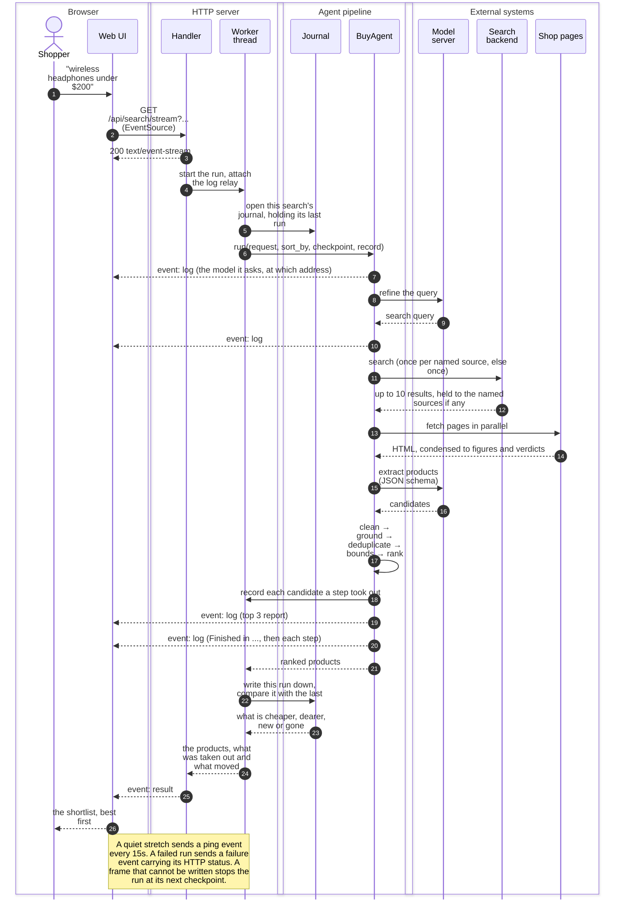

Every run that returns names the model it asked and ends with how long it took,
the whole then each step, timed in `agent.py` and written by
`logging_setup.seconds_label`, which the benchmark shares (ADR-0084). Where a run
is deterministic, page text and the model's answers come off disk for as long as
`cache_ttl` allows (ADR-0040, ADR-0044). Only query refinement is recoverable,
falling back to the raw request; otherwise `BuyAgent.run()` raises exactly
`ValueError`, `ModelUnavailableError` or `SearchError`, which `api._STATUS` maps
to 400, 503 and 502, the provider writing the remedy the middle one carries.
